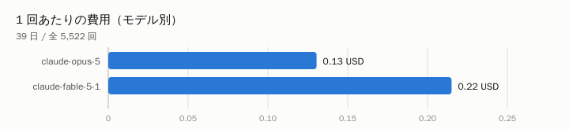
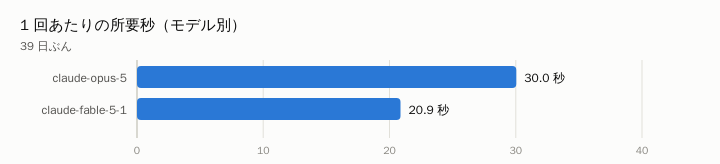

自宅で動かしている Bot 1 本が、39 日で Claude を **5,522 回**呼びました。
モデルごとに **1 回あたりいくらかかったか**を実測で並べます。

## 結論

| モデル | 回数 | 1 回あたり | 倍率 | 1 回の所要秒 |
| --- | --- | --- | --- | --- |
| claude-opus-5 | 3,115 | $0.1305 | 1.00 倍 | 30.0 秒 |
| claude-fable-5-1 | 2,407 | $0.2150 | 1.65 倍 | 20.9 秒 |

**世代が上がるほど高くなります。** いちばん安いものを 1 とすると、
最大で **1.6 倍**です。

⚠ **速さは順番になっていません。**

「高い＝遅い」でも「新しい＝速い」でもない、というのがこの 2 枚の図の要点です。

## 39 日で $924.06 相当

Bot 1 本ぶんです。同じ調子なら 30 日で **$711 相当**になります。

⚠ **これは「従量で払っていたら」の金額です。** 実際にはサブスクの枠で動かしているので、
この額が請求されているわけではありません。**混ぜて書くと嘘になる**ので分けています。

## 分かったこと

**「新しいほうが良いはず」でモデルを選ぶと、静かに数倍払うことになります。**
判断の質が上がるなら払う価値はありますが、**まず何倍になるかを知ってから決めるべき**でした。
自分の使い方で測るのがいちばん確かです。

---

自宅サーバーの実測を続けて書いています → https://lab.syutonton.com
