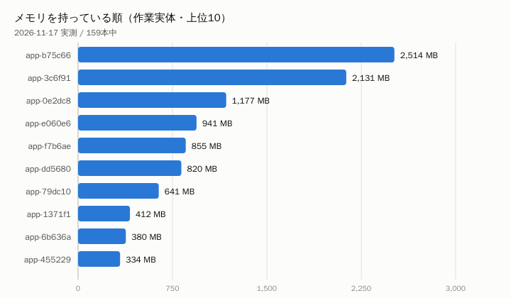
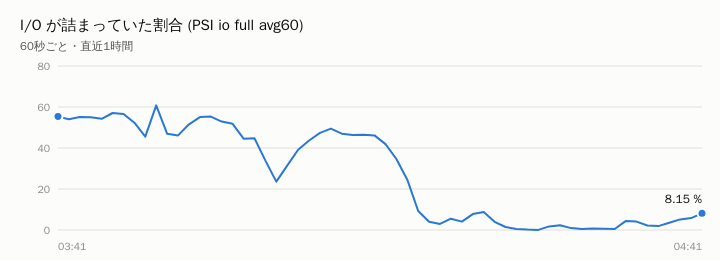

自宅の NAS で 159 本のコンテナを動かしています。
「そんなに動かしてメモリは大丈夫なのか」とよく聞かれるので、実際に測りました。

## 結論

- 1 本あたりのメモリは**中央値 22.3 MB / 平均 105.4 MB**。
  **4.7 倍ずれます**
- 159 本のうち **139 本が 128MB 未満**
- 合計 16.4 GB のうち、**上位 3 本だけで 5.7 GB（34.7%）**

つまり「本数を減らす」はほぼ効きません。効くのは**特定の 3 本**だけです。

平均が中央値の 4.7 倍になるのは、上位数本が桁違いに大きいからです。
**平均で語ると判断を間違えます。**「100 本動かしている」と聞いて想像するのは平均のほうですが、
実際は大半が数十 MB で、重いのはいつも同じ数本です。

## メモリの上限を掛けていないコンテナが 64 本ある

159 本のうち **64 本**は上限を設定していません。
それでも破綻していないのは、上限なしのコンテナが実際には数十 MB しか使っていないからです。
**上限は「危ない数本」に掛ければ足りる**、というのが実測から言えることです。

## 詰まり具合は「たまに重い」ではなく常態

この機体で効いているのはメモリより **I/O** でした。

`/proc/pressure/io` の full は「全タスクが I/O 待ちで完全に止まっていた割合」です。
直近で **8.2%**。体感の「たまに固まる」ではなく、**常時この割合で止まっています**。

## 測り方（自分のサーバーでもできます）

特別な権限は要りませんでした。

- **コンテナの中からホストの `/proc/pressure` と `/proc/meminfo` がそのまま見えます。**
  `--privileged` も `/proc` のマウントも要りません
- コンテナごとの数字は Docker API の `/containers/<id>/stats?stream=false&one-shot=true`。
  `one-shot` を付けないと Docker が 1 本ごとに約 1 秒待つので、159 本で 159 秒かかります。
  付ければ待たない代わりに CPU 割合が空で返るので、**前回との差を自分で取ります**
- メモリの「作業実体」は `usage - stats.cache`（docker 本体と同じ勘定）

この計測そのものの重さは **1 周 1057 ms（最大 119323 ms）・
常駐 14MB 弱**でした。15 分に 1 回動かしています。
**観測のために対象を重くしていない**ことは、測る側も測っておくべきだと思います。

---

自宅サーバーの実測を続けて書いています → https://lab.syutonton.com
