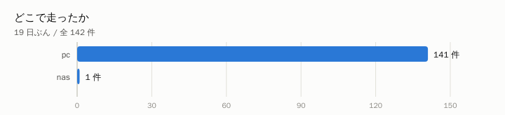

重い処理を自宅 NAS から別の PC へ逃がす仕組みを 19 日動かして、
**その保険が実際に何回使われたか**を数えました。

## 結論

- 全 **142 件**のうち、PC で走ったのが **141 件**、
  NAS に落ちたのが **1 件（0.7%）**
- 1 件あたりの実行時間は **PC 59 秒 / NAS 0 秒**。
  同じ仕事が NAS だと **0.0 倍**かかっています
- PC で走ったもののうち失敗は **7 件**（5.0%）

## 保険は 6% しか使われていない。それでも外せない

「PC が寝ていたら NAS でやる」という代替の道は、0.7% しか使われていません。
使われないなら要らないように見えますが、**外すとその 0.7% が丸ごと失敗**になります。

そして重要なのは、**NAS に落ちた 1 件の合計 0.0 時間**が、
この機体でいちばん重かった時間だということです。
逃がす目的は速さではなく、**その間ほかのコンテナを巻き添えにしないこと**でした。

種類で見ると shell が 140 件で最多です。

## 分かったこと

**「速いから逃がす」ではありません。** 0.0 倍という差はもちろん効きますが、
NAS で数百秒の処理を走らせると、その間ほかの処理が I/O 待ちで止まります。
**逃がす価値は、止まらない時間のほうにあります。**

---

自宅サーバーの実測を続けて書いています → https://lab.syutonton.com
